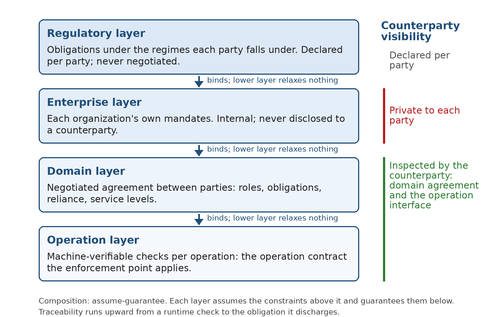

.. _chapter-architecture:

Four-layer contract architecture
================================

From drivers to agreements
--------------------------

Identifying drivers and owners is necessary and insufficient. For coordination
to be operational, each obligation has to be stated where the party that owes
it can be held to it, and carried to the point where an agent acts. The
architecture in this chapter translates the drivers into agreements at four
layers. Each layer is traceable to the one above. The lowest layer is stated
in a form an enforcement point can check.

    The four-layer contract architecture. Each layer binds the one below it.
    A lower layer satisfies the constraints of the layer above and relaxes
    none. A counterparty inspects the domain and operation layers and needs
    nothing from the other party's enterprise layer.

The layers
----------

Regulatory layer
    Each party records and references the obligations that apply to it under
    the regimes whose jurisdiction it falls under, for example the EU AI Act
    or the GDPR for a party operating within their reach. These obligations
    admit no negotiation. The layer is prose. A legal person is accountable
    for its reading. Where two parties operate under different regimes, each
    party's regulatory layer constrains its own side of the domain layer
    between them.

Enterprise layer
    Each organization's own mandates for its involvement in agentic AI
    development and deployment, stated once for the organization and applying
    to every business function. The enterprise layer is internal and is never
    disclosed to a counterparty.

Domain layer
    The negotiated agreement between organizations for a value stream or
    business domain: roles, responsibilities, what each party may rely on
    from the other, and measurable service levels. For example, an EU AI Act
    Article 25 written agreement belongs at this layer. Recognition between
    parties under different regimes is expressed at this layer, as terms both
    accept. The agreement is written for people. The parts the operation
    layer depends on (the identifier of the agreement, the obligation each
    operation implements, the service levels it must meet) are stated in a
    form the operation contracts can reference and the coherence check can
    test.

Operation layer
    The machine-verifiable checks that implement the domain-layer agreement
    at runtime, using the Design by Contract constructs of preconditions,
    postconditions and invariants [Meyer1992]_ adapted to operations carried
    out by agents. This is the object FG-TIDA WG2 carries as the operation
    contract in force (FG-TIDA/themes#60, part B): what the agent may commit
    to without independent verification, the checks before and after
    commitment, which party performs each, and the disposition when an input
    is absent, stale or outside its declared bound.

Composition rule
----------------

The layers compose by an assume-guarantee scheme. A higher layer assumes
that the layers below it uphold its constraints. Each lower layer guarantees
that it does. A lower layer may add constraints of its own. It may never
relax one from above. Three properties follow.

Traceability
    An auditor can follow a runtime check at the operation layer to the
    domain term it implements, to the enterprise mandate that term satisfies,
    and to the regulatory obligation the mandate addresses. Where the
    obligation has a semantic residual, the trace ends at the residual's
    declaration and owner. The trace is also how an artifact references the
    policy it was issued under. The reference names the agreement. It stays
    stable when any one layer beneath it is reissued.

Confidentiality by construction
    A lower layer never relaxes an upper one. A counterparty therefore learns
    everything it may rely on from the domain agreement and from the
    operation-layer interface beneath it. The other party's enterprise layer
    stays private. The same holds across jurisdictions. Each party's regulatory layer binds its own side of
    the domain agreement. Both parties inspect the agreement and nothing
    above it.

Independent evolution
    A party may change its enterprise layer at will, provided its domain
    agreements still hold. A change that would relax a domain term requires
    renegotiation. A change that tightens an internal mandate requires none.

Coherence at layer boundaries
-----------------------------

Two coherence conditions hold the architecture together. Both are checked
before deployment and again when any layer changes.

Within a layer
    The contracts at one layer contain no contradiction with each other. At
    the operation layer this is the pre-deployment coherence check of the
    containment architecture [ElBendary2026a]_. The contract set is checked
    as a whole for contradictions and coverage gaps. A legal person approves
    it before production.

Across layers
    No contract at a lower layer relaxes a constraint at the layer above.
    When an upper layer changes, every contract beneath it is re-checked. A
    contract that no longer satisfies its upper layer is incoherent. No
    further acts proceed under it until the check passes again. A change at
    the regulatory or domain layer therefore reaches the point of action
    through the operation contract's own lifecycle. That is the mechanism by
    which a withdrawn basis or an amended obligation takes effect.

The second condition is what distinguishes this architecture from a static
policy document. The connection decision studied under FG-TIDA/themes#29
gains its change behaviour from it. A basis that is signed, unexpired and in
scope at the operation layer, and withdrawn at the domain layer, is caught at
the next coherence check.

What crosses an organizational boundary
---------------------------------------

The architecture draws the boundary between organizations at the domain
layer. What crosses it is what the counterparty must depend on to make its
own decisions, and no more. From the domain layer: the terms the counterparty
relies on. From the operation layer: for each operation the counterparty
interacts with, the interface the contract exposes (the operation's
identifier, version and hash; the preconditions the counterparty must satisfy
or may rely on; the dispositions it will see) and the decision outcome the
counterparty is entitled to. The contract's internal conditions and the
decision record's internal content stay with the producing party, except
where a domain term or a record-side requirement under FG-TIDA/themes#1 calls
for them. Nothing from the enterprise layer crosses. Nothing from one party's
regulatory layer crosses except as reflected in the domain agreement both
accepted.

This matches the line FG-TIDA has drawn elsewhere. The conferral record
(FG-TIDA/themes#5) is a domain-layer object. The decision record
(FG-TIDA/themes#60, part C) is an operation-layer object. A finding received
under FG-TIDA/themes#13 is an input whose standing is given by domain-layer
terms, and it confers no authority of its own.

Relation to the containment architecture
----------------------------------------

The operation layer is where this contribution meets the agentic AI
containment architecture [ElBendary2026a]_, from which the least-agency
requirements the author contributed on FG-TIDA/themes#4 derive. That
architecture binds every operation contract to a verifier, separates actor
and verifier roles, binds each execution to the value stream and instance it
serves, resets agent state between instances, admits knowledge to persistent
memory only after verification, and requires deterministic verifiers for
structural properties. The four-layer architecture supplies the three layers
above it: where the contract's conditions come from, who agreed to them, and
what must be re-checked when they change. The two are designed to be used
together. The Propose-Verify-Act-Verify execution model is the runtime form
of the operation layer.
